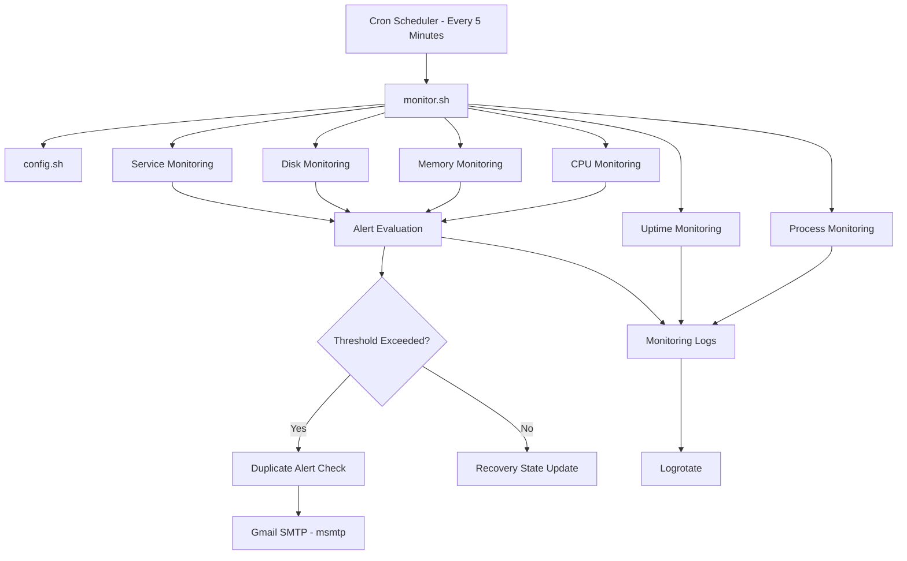

# Linux Server Monitoring and Email Alert System

A Bash-based Linux server monitoring project that automatically tracks system health, monitors critical services, records logs, and sends Gmail alerts when configured thresholds are exceeded.

## Project Overview

This project automates essential Linux server health checks using Bash scripting, Cron, Logrotate, and Gmail SMTP.

It helps administrators identify resource issues and service failures before they become major problems.

## Architecture



## Features

- **CPU Monitoring:** Tracks CPU utilization using `/proc/stat`.
- **Memory Monitoring:** Calculates memory usage using `free`.
- **Disk Monitoring:** Checks disk utilization using `df`.
- **Process Monitoring:** Displays the top five CPU-consuming processes.
- **Service Monitoring:** Checks SSH and Nginx service status.
- **Uptime Monitoring:** Reports system uptime.
- **Automated Scheduling:** Executes health checks every five minutes using Cron.
- **Email Alerts:** Sends Gmail notifications when configured thresholds are exceeded.
- **Duplicate Alert Prevention:** Avoids repeatedly sending identical alerts.
- **Recovery Detection:** Clears previous alert state when monitored conditions recover.
- **Log Management:** Stores monitoring output and rotates old logs using Logrotate.

## Technologies Used

| Technology | Purpose |
|---|---|
| Bash | Monitoring automation |
| Ubuntu | Linux environment |
| Cron | Scheduled execution |
| Logrotate | Log rotation and retention |
| msmtp | Gmail SMTP notifications |
| systemctl | Service monitoring |
| awk | Text processing and calculations |
| ps | Process monitoring |
| df | Disk utilization |
| free | Memory utilization |

## Project Structure

```text
linux-server-monitor/
├── monitor.sh
├── config.sh
├── logs/
│   ├── monitor.log
│   ├── cron.log
│   └── alert_state
├── screenshots/
└── README.md
```

## Configuration

Update `config.sh` with your monitoring thresholds and services:

```bash
CPU_THRESHOLD=80
MEMORY_THRESHOLD=80
DISK_THRESHOLD=85

LOG_FILE="$HOME/linux-server-monitor/logs/monitor.log"
ALERT_STATE_FILE="$HOME/linux-server-monitor/logs/alert_state"

SERVICES=("ssh" "nginx")

ALERT_EMAIL="your-email@gmail.com"
```

Replace the email placeholder with your Gmail address.

## Installation and Setup

### 1. Install required packages

```bash
sudo apt update

sudo apt install -y \
    msmtp \
    msmtp-mta \
    mailutils \
    logrotate \
    cron
```

### 2. Configure Gmail SMTP

Enable Google 2-Step Verification and generate a Google App Password.

Configure `~/.msmtprc` with your Gmail SMTP details.

Secure the configuration:

```bash
chmod 600 ~/.msmtprc
```

**Security:** Never upload your Gmail App Password or `.msmtprc` file to GitHub.

### 3. Make the script executable

```bash
chmod +x monitor.sh
```

### 4. Check script syntax

```bash
bash -n monitor.sh
```

### 5. Run the monitoring script

```bash
bash monitor.sh
```

### 6. Configure Cron

Edit the current user's crontab:

```bash
crontab -e
```

Add:

```cron
*/5 * * * * /bin/bash /home/swe/linux-server-monitor/monitor.sh >> /home/swe/linux-server-monitor/logs/cron.log 2>&1
```

This schedules monitoring every five minutes.

### 7. Configure Logrotate

Create the configuration:

```bash
sudo nano /etc/logrotate.d/linux-server-monitor
```

Add:

```conf
/home/swe/linux-server-monitor/logs/monitor.log {
    daily
    rotate 7
    compress
    delaycompress
    missingok
    notifempty
    copytruncate
    su swe swe
}
```

This keeps seven rotated daily log files.

## Testing and Verification

Run these commands to verify the project:

```bash
bash -n monitor.sh
bash monitor.sh
```

Check monitoring logs:

```bash
tail -20 logs/monitor.log
```

Check Cron configuration:

```bash
crontab -l
```

Check Cron service:

```bash
sudo systemctl status cron
```

Test Logrotate:

```bash
sudo logrotate -d /etc/logrotate.d/linux-server-monitor
```

To test email alerts, temporarily lower a monitoring threshold in `config.sh`, run the script, and restore the original threshold afterward.

## Learning Outcomes

Through this project, I practised:

- Linux system monitoring and troubleshooting.
- Bash scripting and automation.
- Cron scheduling and background execution.
- Linux process and service management.
- Disk and memory utilization checks.
- Log management and rotation.
- SMTP email integration.
- Alert-state tracking and duplicate notification prevention.

## Future Improvements

- Add Slack or Microsoft Teams notifications.
- Build a Streamlit monitoring dashboard.
- Monitor multiple Linux servers remotely.
- Add historical CPU, memory, and disk usage reports.
- Integrate Prometheus and Grafana.

## Project Status

**Completed:** Core monitoring, automated scheduling, log management, and Gmail alert integration.
